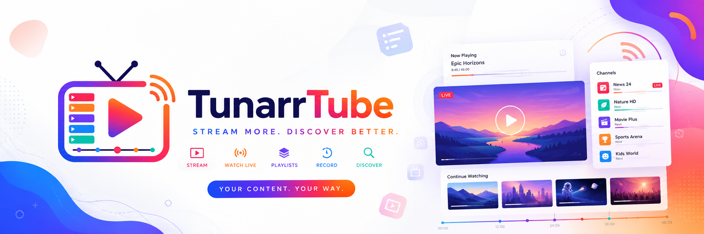
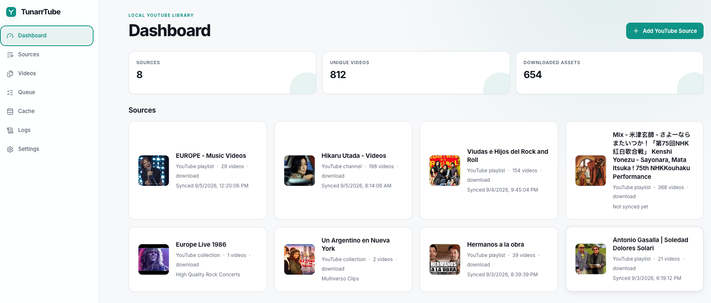

# TunarrTube



Turn public YouTube videos, playlists, and channels into a local media library and publish them as live-TV-style channels in [Tunarr](https://tunarr.com).

TunarrTube is a self-hosted, local-first companion for Tunarr. It discovers videos with `yt-dlp`, stores its catalog in SQLite, downloads or streams media according to each source's retention policy, and keeps linked Tunarr channels up to date.

> [!IMPORTANT]
> TunarrTube is pre-1.0 software for one trusted operator. By default it has no login. Keep it on localhost, or set `TUNARRTUBE_AUTH_PASSWORD` (see [Optional password](#optional-password)) and/or put it behind an authenticated reverse proxy or VPN; do not expose it directly to the internet or an untrusted LAN.

## Features

- Import a public YouTube video, playlist, or channel.
- Select channel feeds: Videos, Shorts, archived Live streams, or all feeds.
- Preserve playlist order and detect additions or removals during manual or scheduled syncs.
- Choose permanent downloads, cache-on-first-play, or stream-on-demand per source.
- Produce stable MP4 files with JSON and NFO metadata sidecars.
- Create or update Tunarr Local Media sources and channels, with a check that Tunarr can actually serve the published guide before calling a publish successful (see **Known issues** below).
- Curate a **Channel**: a hand-picked, ordered lineup of clips (from an already-downloaded video, a pasted YouTube URL, or a local folder) with a burned-in overlay (artist/title/album, or a custom HTML/CSS template you design), published as its own Tunarr channel.
- Pick clips onto a Channel at scale with **Content selection**: AI (a free-text brief interpreted by your configured AI provider) or Smart/heuristic (no AI provider needed — freshness, spread across sources, and optional target length or per-source/artist grouping).
- **AI Programming**: turn a Source or Channel into a real dayparts/weekly or endless-rotation schedule via Anthropic, OpenAI, or a locally installed Claude Code CLI (no API key needed for that path) — including the **AI Programming Director**, a natural-language preview-before-publish workflow, and ready-made concept presets as a starting point.
- Translate media paths when TunarrTube and Tunarr use different host or container paths.
- Monitor background work, cache usage, and sanitized logs from the web interface, with an explicit **Published**/**Publish incomplete** status per channel — see **Known issues**.
- Recover interrupted jobs after a restart without deleting previously completed media.
- Run natively on macOS, Linux, or Windows, or use the included Docker configuration.

## Known issues

- **A specific Tunarr bug can make Tunarr's entire server unresponsive after publishing.** TunarrTube verifies each publish's guide before reporting success and won't leave a channel showing **Published** unless that check passes — but it can't fix the underlying bug, which lives in Tunarr itself. See [chrisbenincasa/tunarr#2087](https://github.com/chrisbenincasa/tunarr/issues/2087) and ["A channel shows 'Publish incomplete'..."](#a-channel-shows-publish-incomplete-or-tunarr-stops-responding-after-publishing-an-ai-scheduled-channel) below if you hit it.
- **Single instance only.** The job worker and scheduler keep their state in-process with no distributed locking — never run more than one TunarrTube process against the same SQLite database.
- **A Tunarr channel can never stream a video live from YouTube**, in any playback mode — Tunarr's local-media scanner only reads real files on disk. See the FAQ entry below.
- **Claude Code AI Programming uses your real Claude usage**, not a separate fee — see **Claude Code Integration** below before enabling it.
- No login system — see the notice above.

## Screenshots



## How it works

```text
Video URL (YouTube, Bilibili, …)
    │
    ▼
yt-dlp analysis ──► SQLite catalog ──► background job queue
                                            │
                          ┌─────────────────┼─────────────────┐
                          ▼                 ▼                 ▼
                    MP4 + sidecars     local cache      live stream
                          │
                          ▼
                  Tunarr Local Media ──► Tunarr channel
```

TunarrTube does not upload video metadata directly into Tunarr. Tunarr scans the shared media directory and reads the generated `.nfo` sidecars. It then matches scanned programs back to TunarrTube records using the video ID recovered from each filename (the whole filename under the default naming scheme, or a trailing `[videoId]` under a custom one — see "Naming" below).

## Quick start with Docker

Docker is the simplest option. The TunarrTube image includes Node.js, `yt-dlp`, and FFmpeg.

### TunarrTube and Tunarr together

```bash
docker compose --profile tunarr up -d --build
```

Open:

- TunarrTube: [http://localhost:3000](http://localhost:3000)
- Tunarr: [http://localhost:8000](http://localhost:8000)

The included stack shares `/media` between both containers and configures TunarrTube to reach Tunarr at `http://tunarr:8000`.

### TunarrTube with an existing Tunarr installation

Create `.env` beside `compose.yaml`:

```dotenv
TUNARRTUBE_TUNARR_URL=http://host.docker.internal:8000
```

Then start only TunarrTube:

```bash
docker compose up -d --build
```

`host.docker.internal` works with Docker Desktop and is configured through `host-gateway` for Linux. If Tunarr is in another Docker stack, connect both services to a shared Docker network and use Tunarr's service name instead.

### Published images

The commands above build the image from your checkout. Each release is also published as a ready-made image for `linux/amd64` and `linux/arm64` (including Apple Silicon and Raspberry Pi 4/5), so you can skip the build:

| Tag | Meaning |
|---|---|
| `ghcr.io/augustosc-eu/tunarrtube:0.5.0` | That exact release (recommended, so upgrades happen only when you choose) |
| `ghcr.io/augustosc-eu/tunarrtube:0.3` | The newest patch release of 0.3 |
| `ghcr.io/augustosc-eu/tunarrtube:latest` | The newest stable release |

Pre-releases (for example `0.5.0-rc.1`) are published only under their exact version. See [Releases](https://github.com/augustosc-eu/TunarrTube/releases) for the available versions and what changed.

To use one with the supplied `compose.yaml`, add the image to `.env`:

```dotenv
TUNARRTUBE_IMAGE=ghcr.io/augustosc-eu/tunarrtube:0.5.0
```

Then pull it and start without building:

```bash
docker compose pull tunarrtube
docker compose up -d
```

To upgrade later, change the version in `.env` and run the same two commands. Your data lives in the Docker volumes, not the image, so it carries over. Back up first, as with any upgrade.

### Docker storage

The supplied Compose file persists:

| Data | Container path | Default volume |
|---|---|---|
| SQLite database and thumbnails | `/config` | `tunarrtube-config` |
| Downloaded and cached media | `/media` | `tunarrtube-media` |
| Channels overlay render cache and staged renders | `/app/storage` | `tunarrtube-storage` |
| Optional Tunarr configuration | `/config/tunarr` | `tunarr-config` |

`/app/storage` is a rebuildable cache (Channels overlay screenshots and staged render outputs) rather
than primary media, but the database keeps referencing paths under it until a render is republished to
a channel, so it's still persisted by default to avoid needlessly re-rendering after a container
recreation.

Docker volumes can't be renamed in place, so `compose.yaml` maps these volume keys onto volumes named `<project>_ytarr-*` — the names they were created under before the project was renamed. Existing installs keep their data with no manual steps, and a fresh install creates the same names. Leave those `name:` lines unchanged, or Compose starts with new, empty volumes.

To make downloaded files directly visible on the host, replace the `tunarrtube-media:/media` mounts in `compose.yaml` with the same bind mount for both services, for example:

- Linux/macOS: `/srv/tunarrtube-media:/media`
- Windows Docker Desktop: `D:/TunarrTube:/media`

TunarrTube needs write access; Tunarr only needs read access. The TunarrTube container runs as UID/GID `1001`.

> [!NOTE]
> The Channels overlay-render feature needs a working headless Chromium in addition to `yt-dlp`/FFmpeg. The Docker image installs Debian's own `chromium` package for this (rather than Puppeteer's own bundled download) and points Puppeteer at it — no extra setup needed.

## Native installation

### Requirements

- Node.js 22.13 or newer
- A current `yt-dlp`
- FFmpeg
- A reachable [Tunarr installation](https://tunarr.com/getting-started/installation/) for channel publishing
- For the Channels overlay-render feature: `npm install` downloads Puppeteer's own bundled Chromium automatically (no separate browser install needed natively). If your environment blocks that download, set `PUPPETEER_SKIP_DOWNLOAD=1` and point `TUNARRTUBE_PUPPETEER_EXECUTABLE_PATH` at an existing Chrome/Chromium binary instead.

### Install dependencies

On macOS:

```bash
brew install yt-dlp ffmpeg
```

On Linux, install FFmpeg using your distribution package manager. Install a current `yt-dlp` using its [official installation instructions](https://github.com/yt-dlp/yt-dlp/wiki/Installation); distribution packages can lag behind YouTube changes.

On Windows, install Node.js 22.13 or newer, [yt-dlp](https://github.com/yt-dlp/yt-dlp/wiki/Installation), and an [FFmpeg Windows build](https://ffmpeg.org/download.html). Add `yt-dlp.exe` and the FFmpeg `bin` directory to `PATH`, open a new PowerShell window, and verify:

```powershell
node --version
yt-dlp --version
ffmpeg -version
```

If either binary is outside `PATH`, configure its absolute path in `.env`:

```dotenv
TUNARRTUBE_YTDLP_PATH="/absolute/path/to/yt-dlp"
TUNARRTUBE_FFMPEG_PATH="/absolute/path/to/ffmpeg"
```

### Start TunarrTube

```bash
npm install
npm run dev
```

Open [http://localhost:3000](http://localhost:3000). For a production build:

```bash
npm run build
npm start
```

To skip the build when nothing changed, use `npm run serve` instead (`npm run serve -- --lan` for all interfaces, `-- --rebuild` to force a build). It backs up the database to `prisma/backups/` (keeping the last 10), runs `npm run build` only if the source changed since the last build, then runs `npm start`.

Both development and production startup generate Prisma Client and apply committed SQLite migrations automatically. `npm start` listens on `127.0.0.1`; `npm run start:lan` deliberately listens on all interfaces — set `TUNARRTUBE_AUTH_PASSWORD` before using it (see [Optional password](#optional-password)).

## Connect to Tunarr

Two connections are required:

1. TunarrTube must be able to reach Tunarr's HTTP API.
2. Tunarr must be able to read the media files created by TunarrTube.

Use this matrix to choose the URL and media setup:

| TunarrTube | Tunarr | Tunarr URL from TunarrTube | Media setup |
|---|---|---|---|
| Native | Native | `http://127.0.0.1:8000` | Use the same absolute media directory in both applications. |
| Native | Docker | `http://127.0.0.1:8000` | Bind-mount the native media directory into Tunarr and add a path mapping if its container path differs. |
| Docker | Native | `http://host.docker.internal:8000` | Bind-mount host media at `/media`; map `/media` to the native path Tunarr sees. |
| Docker | Docker, included stack | `http://tunarr:8000` | Both containers use the shared `/media` volume; no mapping is needed. |
| Docker | Docker, separate stacks | Shared-network service URL or `http://host.docker.internal:<port>` | Give both containers the same volume or bind mount; map paths if mount points differ. |

Configure the URL under **Settings → Tunarr**, then select **Test Tunarr**. Before changing anything, TunarrTube reads `/openapi.json` and verifies that the connected Tunarr version exposes the required API capabilities.

### Path mapping examples

Add an ordered TunarrTube → Tunarr mapping in Settings when the same files have different absolute paths:

| TunarrTube sees | Tunarr sees |
|---|---|
| `/media` | `/data/youtube` |
| `/srv/tunarrtube` | `/media` |
| `/media` | `D:\Tunarr Media` |

Mappings use longest-prefix matching. Leave them empty when both applications see the same absolute path.

## First Tunarr channel (from a Source)

1. Open **Sources → Add Source**.
2. Paste a public HTTPS YouTube video, playlist, or channel URL.
3. For a YouTube channel, choose its feed and history before analyzing: Latest 15, 25, 50, 75, 100, 250, or 500; Custom (1–5,000); or Unlimited. Then analyze it, choose the playback mode, and create the source. The history amount also applies to future syncs and does not delete older downloads.
4. Wait for at least one download to complete. Permanent-download sources queue all discovered videos automatically.
5. Open the source's **Tunarr integration** panel.
6. Choose a channel name, optional channel number, and programming order.
7. Select **Create Tunarr Channel**.

Publishing creates or reuses a Local Media source for the directory, waits for Tunarr's scan, and creates the channel lineup. Publishing again updates the linked channel instead of creating a duplicate.

## First curated Channel (with an overlay)

A **Channel** (the entity under the **Channels** tab, distinct from a Source's own Tunarr channel above) lets you hand-pick clips and burn in a title/artist overlay before publishing:

1. Open **Templates** once to confirm the built-in "Music Video Lower Third" template exists (it seeds itself automatically), or design your own with the visual drag-and-drop editor. The editor places text elements bound to clip metadata, and static PNG/GIF images (a logo bug, for example) — an animated GIF is baked in as a single still frame, it doesn't play in the render. Templates you create can be deleted from their editor page; built-in templates and ones still assigned to a channel can't be.
2. Open **Channels → New channel**, name it, and pick a template.
3. On the channel's page, add media: pick an already-downloaded video, paste a YouTube URL (downloaded through a Source created automatically for this channel — visible under **Sources**), or scan a local folder. For picking several clips at once from a Source's library, use the **Content selection** panel instead: **AI** takes a free-text brief ("only upbeat J-pop, skip anything acoustic") and asks the configured AI provider which clips fit; **Smart** needs no AI provider at all — it deterministically mixes in clips that are freshest, haven't been picked onto a channel before (or not in a while), spread across your chosen sources, and optionally close to a target clip length, or (in its "grouped by show or artist" style) plays each source/artist as its own back-to-back block.
4. Each clip gets an artist automatically where possible: first from YouTube's own tags (when yt-dlp reports a video as official music content), otherwise from a background MusicBrainz/iTunes search applied only when it's confident enough (tune this in Settings). Edit any clip's title/artist/album directly, or use **Look up** to search and apply a match yourself — including when the automatic search wasn't confident enough to apply one.
5. Select **Render all**, then wait for rendering to finish (check **Queue**). Open a rendered clip's page to preview it inline, see its file size/duration, copy its on-disk path, or **Show in file manager** to reveal the rendered `.mp4` where it lives on disk.
6. Open the channel's **Tunarr** panel and select **Publish to Tunarr**.

This creates a second, independent Tunarr channel alongside any Source-based ones.

## AI Programming

Instead of a fixed sort order, a Source or Channel can hand its programming to an AI provider (Anthropic or OpenAI): pick **AI Programming** as the programming order, optionally describe how you want it scheduled (e.g. "mornings should be calmer clips, evenings more upbeat"), and publish. TunarrTube asks the provider for a repeating daily schedule of named blocks (e.g. "Morning", "Primetime"), each with an ordered clip list, then creates one real Tunarr **Custom Show** per block and a native Tunarr **time-slot schedule** referencing them — this is Tunarr's own dayparting feature, not something TunarrTube simulates on top of a flat lineup.

- Requires `TUNARRTUBE_ANTHROPIC_API_KEY` and/or `OPENAI_API_KEY` in the environment (see Configuration below) — no API key is ever stored in the database or shown in the UI. The Anthropic key uses a `TUNARRTUBE_`-prefixed name rather than the bare `ANTHROPIC_API_KEY` so it can't collide with that variable's separate, unrelated meaning to the `claude` CLI itself (which treats its presence as an API-key login, overriding a claude.ai account login). As an alternative that needs no API key at all, see **Claude Code Integration** below.
- Choose a provider globally in **Settings**, or override it per Source/Channel; leaving it as "auto" picks whichever single key is configured (having both set requires an explicit choice, so a request never silently runs against the wrong provider and bills the wrong account).
- Regenerating a schedule is a real, billed call to the configured provider. TunarrTube only calls it again when the candidate clips or your instructions actually changed since the last publish — an unrelated republish (a new video, a renumber) reuses the cached schedule and just updates the same Tunarr Custom Shows in place.
- Requires a Tunarr server whose Custom Shows API (`/api/custom-shows`) is available — checked the same way every other required capability is, via `/openapi.json` discovery, and only when AI Programming is actually selected.
- **Schedule style** picks the shape of the schedule: **Daily dayparts** and **Weekly broadcast** are both fixed-time schedules (Tunarr's own "time slots"), the only difference being whether the AI plans one repeating day or a different lineup per weekday. **Endless rotation** has no fixed times at all — the AI groups clips with a relative weight and cooldown, and Tunarr shuffles them forever (its "random slots" engine), good for a channel that should just feel like a themed radio/video rotation.
- **Concept preset** is a shortcut for the instructions box (Balanced variety, Throwback/retro countdown, Late night chill, High energy/party, or Custom) — it just fills in a starting point you can still edit before publishing.
- Every AI-generated schedule is dry-run through Tunarr's own schedule preview endpoints before being published, and refused (not silently published) if the preview looks broken (a non-finite duration, or a block Tunarr's scheduler never actually reaches) rather than risk a channel with no real programming.

### Claude Code Integration

As an alternative to the Anthropic API, TunarrTube can run AI Programming through a locally installed **Claude Code CLI**, using your existing Claude Code sign-in — **no Anthropic API key is required for this provider**, and none of your Claude Code credentials ever pass through TunarrTube's own request/response bodies or get stored in its database. This is entirely optional: if you never enable it, TunarrTube behaves exactly like it always has, and if the `claude` executable isn't installed, every other feature keeps working normally.

To set it up:

1. **Install Claude Code** on the same machine (or container) running TunarrTube. See [claude.com/claude-code](https://claude.com/claude-code).
2. **Authenticate** by running `claude` once from a terminal and signing in.
3. In TunarrTube, open **Settings → AI Assistant** and turn on **Enable Claude Code integration**. If auto-detection can't find the binary, set an explicit **Claude executable path**.
4. Click **Test connection** — this runs one real, short round-trip through the CLI (a fixed test prompt, never anything you typed) and reports whether it's genuinely working.
5. Pick **Claude Code (Local)** as the AI provider — globally in Settings, or per Source/Channel — and use AI Programming (or the **AI Programming Director**, below) as usual.

A few things worth knowing:

- Claude Code integration is optional. Existing TunarrTube functionality does not depend on it, and "auto" provider resolution never silently picks it — you always have to select it explicitly.
- TunarrTube shells out to the `claude` CLI as a plain child process (`claude -p --output-format json --max-turns 1 --restricted --tools ""`, with the prompt sent over stdin rather than as a command-line argument), with tool use disabled — it's used purely as a language-model inference process, never given filesystem, command-execution, or repository access, and it can never mutate TunarrTube's database or lineup directly.
- Calls run with a configurable timeout (10–600s, default 120s) and are capped to a couple of concurrent invocations at a time, so TunarrTube never launches a pile of `claude` processes at once.
- **This uses your Claude subscription's usage, not a separate bill.** Each call (even a trivial one) reports a nontrivial cost-equivalent in TunarrTube's logs — this reflects real usage against your plan's limits, not a fee on top of it, but it's not free/instant either. Use **Test connection** and **Preview Schedule** deliberately rather than repeatedly.
- If Claude Code isn't installed, isn't authenticated, or is disabled in Settings, you'll get a clear message ("Claude Code was not detected or is not authenticated. Install Claude Code and run `claude` once from Terminal to sign in.") rather than a silent failure — and every other TunarrTube feature is entirely unaffected.

### AI Programming Director

The **AI Programming Director** (shown on a Channel's Tunarr panel when AI Programming is selected) lets you describe a schedule in plain language — e.g. *"Program this channel from 18:00 until midnight, playing episodes in order, and keep the schedule close to 30-minute blocks"* — and preview exactly what the configured AI provider (Anthropic, OpenAI, or Claude Code) proposes before anything is saved:

1. Type your request and click **Preview Schedule**. TunarrTube gathers this channel's own curated clips (never anything outside it), asks the AI for a schedule, and shows you the result: proposed blocks or rotation groups, computed start/end times and durations, and any warnings (clips that weren't used, overlapping blocks, or a request — like per-item filler — that TunarrTube's schedule shape doesn't support).
2. **Regenerate** to try again, or **Cancel** to discard the preview without changing anything.
3. **Apply Schedule** saves the same programming settings the manual AI Programming panel above it already uses, then republishes through the exact same Tunarr publish path as any other AI-scheduled channel — the AI never writes to the lineup or to Tunarr directly.

## Playback and retention

| Mode | Initial behavior | On browser playback | When publishing to Tunarr |
|---|---|---|---|
| Permanent download | Queues every discovered video | Plays the local file | Uses the existing local file |
| Cache on first play | Stores metadata only | Downloads into the shared cache | Materializes permanent local files first |
| Stream on demand | Stores metadata only | Proxies a short-lived YouTube stream | Materializes permanent local files first |

Stream on demand works for YouTube and Internet Archive only. Sources from other sites can't select it, and such a video added to a stream-mode collection is cached on first play instead.

Cache limits default to 20 GB and 30 idle days and can be changed in Settings. Pinned, actively playing, and Tunarr-linked assets are protected from eviction.

> **A Tunarr channel never plays a live YouTube stream, regardless of playback mode.** Tunarr's local-media scanner only reads real files sitting in a directory it's watching — it has no way to accept a remote URL per program, and the short-lived signed CDN URL TunarrTube resolves for `stream` playback expires far too quickly to serve a channel that might replay that item hours or days later. So publishing a Cache or Stream source still fully downloads (materializes) every video into the source's directory first, exactly like Permanent download — the playback mode only changes *when* and *how long* that copy is retained outside of Tunarr publishing, not whether Tunarr channels stream live. Live, on-demand streaming without ever writing a file only happens in TunarrTube's own in-app preview player, never in a published Tunarr channel.

Manual or scheduled synchronization detects new videos and marks missing memberships without deleting previously completed downloads. Channel sources can limit how much recent history is inspected. Run only one TunarrTube process against a given SQLite database; the worker and scheduler are intentionally single-instance.

## API integrations

TunarrTube exposes its HTTP API as an OpenAPI 3.1 document at [`/openapi.json`](http://localhost:3000/openapi.json). Import that URL into Postman, Insomnia, n8n, or an OpenAPI client generator. Operations have stable `operationId` values. JSON successes use `{ "data": ... }`; JSON failures use `{ "error": { "code": "...", "message": "...", "details": ... } }`.

API operations can start background jobs, write media, change filesystem destinations, and mutate the configured Tunarr server. Unless `TUNARRTUBE_AUTH_PASSWORD` is set there is no authentication, so keep TunarrTube on localhost or a trusted private network; for remote integrations, also place it behind a reverse proxy or VPN with TLS. With a password set, pass it with curl's `-u admin:<password>`.

### Optional password

Set `TUNARRTUBE_AUTH_PASSWORD` (and optionally `TUNARRTUBE_AUTH_USERNAME`, default `admin`) to require HTTP Basic authentication for every page and API route. Your browser shows its own sign-in prompt and remembers the credentials for the session. `/api/health` stays open so container health checks keep working. The password is read only from the environment — it is never stored in the database or shown in the UI. Basic authentication sends the password with every request, so over an untrusted network serve TunarrTube through an HTTPS reverse proxy.

Independently of the password, state-changing API requests that a browser marks as coming from another site — including another port on the same host — are rejected.

```bash
curl http://localhost:3000/api/sources
curl -X POST http://localhost:3000/api/sources/analyze \
  -H 'Content-Type: application/json' \
  -d '{"url":"https://www.youtube.com/playlist?list=YOUR_PLAYLIST_ID"}'
```

## Configuration

Copy `.env.example` to `.env` only when you need overrides. Environment settings seed the application on its first start; afterward, change the media directory and Tunarr URL in the Settings page. The Settings page also has a **MusicBrainz contact email** field — MusicBrainz's API usage policy requires a real contact identifier in the request `User-Agent` for the Channels metadata-lookup feature — plus toggles to enable/disable the MusicBrainz and iTunes lookups individually and an **auto-apply confidence threshold** (0-100) controlling how sure the automatic artist lookup (see above) needs to be before it applies a match on its own; anything scoring below the threshold is left for you to resolve manually via **Look up**.

| Variable | Purpose | Default |
|---|---|---|
| `DATABASE_URL` | Prisma SQLite connection | `file:./tunarrtube.db` |
| `TUNARRTUBE_YTDLP_PATH` | Absolute `yt-dlp` executable path | Auto-discovered |
| `TUNARRTUBE_FFMPEG_PATH` | Absolute FFmpeg executable path | Auto-discovered |
| `TUNARRTUBE_MEDIA_DIR` | Initial media root | `storage/media` |
| `TUNARRTUBE_THUMBNAIL_DIR` | Thumbnail storage root | `storage/thumbnails` |
| `TUNARRTUBE_YTDLP_COOKIES` | Initial `yt-dlp` cookies file path (see "Age-restricted or sign-in-required videos" below) | None (unauthenticated) |
| `TUNARRTUBE_TUNARR_URL` | Initial Tunarr base URL | `http://127.0.0.1:8000` native; `http://tunarr:8000` in Compose |
| `TUNARRTUBE_GENERAL_WORKERS` | How many lightweight non-download/cache/render jobs run concurrently | `3` |
| `TUNARRTUBE_DOWNLOAD_CONCURRENCY` | Shared media-fetch limit across queued downloads, cache fills, and Tunarr materialization | `1` |
| `TUNARRTUBE_RENDER_THREADS` | FFmpeg encoder/filter thread budget for the single render lane | `2` |
| `TUNARRTUBE_FFPROBE_PATH` | Absolute `ffprobe` executable path (used by Channels rendering) | Auto-discovered |
| `TUNARRTUBE_ANTHROPIC_API_KEY` | Enables Anthropic (Claude) as an AI Programming provider | None (feature unavailable if unset) |
| `OPENAI_API_KEY` | Enables OpenAI as an AI Programming provider | None (feature unavailable if unset) |
| `TUNARRTUBE_AUTH_PASSWORD` | Requires HTTP Basic sign-in for the UI and API (see [Optional password](#optional-password)) | None (no sign-in) |
| `TUNARRTUBE_AUTH_USERNAME` | Username for `TUNARRTUBE_AUTH_PASSWORD` | `admin` |
| `TUNARRTUBE_ANTHROPIC_MODEL` | Anthropic model used for AI Programming | `claude-opus-5-5` |
| `TUNARRTUBE_OPENAI_MODEL` | OpenAI model used for AI Programming (must support structured outputs) | `gpt-5` |
| `TUNARRTUBE_CLAUDE_PATH` | Absolute `claude` (Claude Code CLI) executable path, used when Settings' own path override is unset | Auto-discovered |
| `TUNARRTUBE_PUPPETEER_EXECUTABLE_PATH` | Absolute Chrome/Chromium path for Channels overlay rendering | Puppeteer's own bundled Chromium |
| `TUNARRTUBE_PORT` | Docker host port | `3000` |
| `TUNARR_PORT` | Optional Tunarr Docker host port | `8000` |
| `TUNARRTUBE_IMAGE` | Published TunarrTube image to run instead of building this checkout (see [Published images](#published-images)) | `tunarrtube:local` (built from source) |
| `TUNARR_IMAGE` | Optional Tunarr image tag or digest | `chrisbenincasa/tunarr:latest` |
| `TZ` | Container timezone | `UTC` |

The pre-rename `YTARR_*` names (and `YTARR_PORT` for Compose) still work as fallbacks, but are deprecated: TunarrTube logs a warning at startup naming each one it finds, so you can rename it to the `TUNARRTUBE_*` equivalent.

Native defaults:

- Database: `prisma/tunarrtube.db`
- Media: `storage/media/`
- Thumbnails: `storage/thumbnails/`
- Source files: `<media-root>/<source-directory>/<youtubeId>.mp4` by default (see "Naming" below for custom filename/folder layouts)
- Metadata: matching `<youtubeId>.json` and `<youtubeId>.nfo` files
- Artwork: a matching `<youtubeId>-poster.jpg` (or `.png`/`.webp`) file, mirrored from the video's thumbnail so Tunarr's guide and "now playing" screen have an image for it

### Naming

Settings → Naming controls how downloaded files are named and organized, with a per-source override available on each source's own page:

- **YouTube video ID** (default) — `<mediaDirectory>/<youtubeId>.mp4`, unchanged from every TunarrTube release before this setting existed.
- **Custom filename template** — a template string using `{title}`, `{channel}`, `{date}` (upload date, `YYYY-MM-DD`), `{year}`, and `{videoId}`, e.g. `{channel} - {title}`. A literal `/` in the template creates a subfolder, e.g. `{channel}/{title}` produces `<mediaDirectory>/<channel>/<title>.mp4`. The YouTube video ID is always appended in brackets (`Title [videoId].mp4`) unless the filename already ends with it — a bracket elsewhere in a title (`Mirror [archive.2024]`) is kept as text — so Tunarr can still match the file and two same-titled videos never collide on disk.
- **TV show** — an Emby/Plex/Jellyfin- and Tunarr "Shows"-scanner-compatible layout: `<mediaDirectory>/Season <upload year>/<source name> - S<year>E<episode> - <title> [videoId].mp4`, with a matching Kodi `<episodedetails>` NFO (season/episode/plot/aired date, plus a `<uniqueid type="youtube">` carrying the YouTube ID), a `tvshow.nfo` at the source's root, a `<basename>-thumb.<ext>` episode thumbnail, and a `<basename>.info.json` sidecar carrying the same metadata plus the assigned season/episode. Episode numbers are assigned once per video (first-assigned-wins per season) and never renumbered, so they stay stable even if older videos are discovered later. To have Tunarr itself recognize this layout as a TV show (rather than "Other Videos"), configure a Tunarr local media source of type "Shows" pointed at the source's directory — TunarrTube matches the right library automatically but doesn't create it for you.

Changing a naming setting only affects future downloads — already-downloaded files keep their existing names and locations (same rule as changing the media root above).

Back up the SQLite database and media root before upgrades.

## Operations

- **Queue** shows running, retrying, recently completed work, and queued work in server-paginated pages. Polling pauses while the browser tab is hidden. A queued job (including one waiting to retry) can be cancelled outright or postponed to a later time (15 minutes up to a week) without losing its place; a failed or cancelled one can be retried, which requeues it fresh rather than resuming the old attempt. A running download, cache, sync, metadata, render, or Tunarr publish/refresh job can be stopped mid-flight — Stop immediately records cancellation (even for a stranded job with no live worker), then interrupts its process or network request; cancellation survives a restart. Publishing also passes Stop through to any media downloads it needs; a metadata-repair or thumbnail job has no interrupt point and finishes on its own instead. Cancelling or stopping a download or cache job is sticky — it stays cancelled through automatic syncs and Tunarr refreshes until you retry it (or play the video again, for Cache/Stream sources) or switch the source's playback mode to Permanent, which re-downloads everything not yet complete. The toolbar's Pause queue toggle stops the worker from picking up any new job (existing running work keeps going until it finishes or you stop it) — use it and Resume queue to hold everything for a while. Actual media fetches share one limiter across queued downloads, cache fills, and downloads initiated by Tunarr publishing (`TUNARRTUBE_DOWNLOAD_CONCURRENCY`, default 1). FFmpeg renders use a separate single-job lane with a configurable thread budget (`TUNARRTUBE_RENDER_THREADS`, default 2); lightweight work uses the general lanes (`TUNARRTUBE_GENERAL_WORKERS`, default 3).
- **Cache** shows used, pinned, protected, and evictable storage.
- **Logs** contains sanitized operational events. Signed YouTube/Googlevideo URLs and cookie flags are redacted before persistence. Entries older than the configured log retention (30 days by default, set in Settings) are purged automatically every hour; **Purge old entries** runs that same cleanup immediately, and **Clear all** empties the log table outright.
- **Settings** tests binary discovery and Tunarr connectivity, controls cache limits and log retention, sets the default downloaded filename/folder naming scheme (with a live preview), repairs older metadata sidecars, and previews path mappings.

Downloads are written to temporary paths and renamed into place only after `yt-dlp` and FFmpeg succeed. Interrupted jobs are requeued after restart only while attempts remain; jobs at their retry limit are marked failed and can be retried manually from Queue. Jobs normally retry up to three times — except one YouTube itself reports as permanently unavailable, which fails immediately without retrying (see "A download failed" below).

## Troubleshooting

### `yt-dlp` or FFmpeg is not found

Open Settings to inspect the detected paths and versions. Add `TUNARRTUBE_YTDLP_PATH` or `TUNARRTUBE_FFMPEG_PATH` to `.env` if automatic discovery fails, then restart TunarrTube.

### Downloads fail with "No supported JavaScript runtime" or HTTP 403/500

Current `yt-dlp` needs a JavaScript runtime (plus its `yt-dlp-ejs` solver scripts) to extract YouTube formats; without one, downloads fail with the warning above, and metadata jobs can intermittently fail with `The page needs to be reloaded`. TunarrTube itself always passes `--js-runtimes node --remote-components ejs:github` to every `yt-dlp` invocation (so it uses the Node.js it's already running on, and actually downloads the solver script instead of only warning it was skipped), and caches that download under its own persisted storage (`/config` in Docker, alongside the database; the project directory's `storage/` folder for a host install) rather than `yt-dlp`'s default `~/.cache`, which isn't guaranteed to exist or be writable. The Docker image also ships the dependencies from `yt-dlp[default]` (the extra that includes `yt-dlp-ejs`) — rebuild and redeploy it if you see this on an older image. For a host install, `pip install "yt-dlp[default]"` (or install [Deno](https://deno.com), which `yt-dlp` auto-detects as an alternative runtime). See the [yt-dlp EJS wiki](https://github.com/yt-dlp/yt-dlp/wiki/EJS).

### A URL cannot be analyzed

Only public HTTPS URLs on supported sites are accepted:

- **YouTube** — videos, playlists, and channels on `youtube.com`, `m.youtube.com`, `music.youtube.com`, and `youtu.be`.
- **Bilibili** — videos (`www.bilibili.com/video/BV…` or `av…`, `m.bilibili.com`), profiles (`space.bilibili.com/<uid>`, synced like a YouTube channel — Bilibili profiles have a single uploads feed, so there's no Videos/Shorts/Live choice; collections the uploader hides from that feed are fetched and included, up to 25 per profile, and a profile whose collections can't all be read fails to analyze or sync rather than syncing without them), collections and series (`space.bilibili.com/<uid>/lists/<id>`), and favorites (`space.bilibili.com/<uid>/favlist?fid=…`). Analyzing a multi-part video URL without `?p=N` adds every part; with `?p=N` (or pasted into an existing collection) it adds only that part. Bilibili Live, bangumi (licensed anime), and `b23.tv` short links aren't supported (bilibili.tv, the international site, is listed separately below) — open a short link in a browser and paste the full URL instead. Without a cookies file Bilibili usually limits quality to 480p–1080p; the same cookies-file setting below works for a Bilibili account. Bilibili also blocks some regions ("may be deleted or geo-restricted") and blocks bursts of requests from one connection; see "A site is refusing requests" below.
- **bilibili.tv** (Bilibili's international site, separate from bilibili.com) — uploaded videos (`www.bilibili.tv/<lang>/video/<id>`), show episodes (`/play/<season>/<episode>`), and whole shows (`/play/<season>` or `/media/<id>`, added like a playlist). The legacy `biliintl.com` host works too. yt-dlp can't list an uploader's videos on bilibili.tv, so there are no channel sources, and Stream mode isn't available. Many shows are region-locked, and some videos need a cookies file from a bilibili.tv account.
- **Internet Archive** — items (`archive.org/details/<identifier>`), e.g. public-domain films and old TV. An item with several video files adds every file; a link to one file (`archive.org/details/<identifier>/<file>`) adds just that file. Collections and searches aren't supported, so these sources don't sync. Stream mode works.
- **Vimeo** — videos, users (`vimeo.com/<user>`, synced like a channel), channels (`vimeo.com/channels/<name>`), and showcases/albums. **Vimeo now only serves videos to signed-in clients**, so it needs a cookies file from a Vimeo account (see below); without one, analysis works but every video is marked as requiring sign-in. On Demand and private/review links aren't supported.
- **Dailymotion** — videos (`dailymotion.com/video/x…`, `dai.ly/x…`), users (synced like a channel), and playlists.
- **Twitch** — past broadcasts/VODs (`twitch.tv/videos/<id>`), clips (`clips.twitch.tv/<slug>` or `twitch.tv/<channel>/clip/<slug>`), channels (`twitch.tv/<channel>`, synced from the channel's video list), and a channel's clips (`twitch.tv/<channel>/clips`, all-time, most-viewed first). Twitch deletes past broadcasts after 7–60 days; TunarrTube keeps anything it already downloaded. Live streams and subscriber-only VODs aren't supported.
- **Niconico** — videos (`nicovideo.jp/watch/sm…`, `nico.ms/sm…`), users (`nicovideo.jp/user/<id>`, synced like a channel), mylists, and series. Many videos need a cookies file from a Niconico account, and some are only available from Japan. Niconico Live isn't supported.

One cookies file can hold cookies for several of these sites at once, or give each site its own in Settings → Sites.

Other sites `yt-dlp` supports aren't accepted on purpose: letting `yt-dlp` fetch arbitrary URLs would let anyone with access to TunarrTube make the server request internal network addresses. Sites are added one at a time (see `lib/youtube/sites.ts`). Private/unlisted, account-only, and members-only media are not supported — TunarrTube can't browse a signed-in account's library, only analyze a URL you already have. Age-restricted and bot-checked *public* videos are supported if you configure a cookies file (see "Age-restricted or sign-in-required videos" below); without one they're marked unavailable instead of failing repeatedly.

YouTube changes its extraction behavior regularly. In Settings, click **Update** next to `yt-dlp` to self-update it (no restart needed — TunarrTube re-discovers the binary on each use), then use **Sync Now**. An existing empty source does not need to be recreated. If `yt-dlp` was installed with a package manager (Homebrew, apt, pip), it can't update itself, and **Update** says so and tells you how to update it instead. For Homebrew (the usual macOS install), run `brew upgrade yt-dlp`, then click **Test**. To use **Update** outside Docker, point `TUNARRTUBE_YTDLP_PATH` at a standalone `yt-dlp` release binary. In Docker, the image ships yt-dlp's official self-updating build, so **Update** works there too; an update lasts until the container is recreated, and rebuilding the image picks up the latest release.

### A download failed

Review **Logs** for the sanitized error. Check available disk space, filesystem permissions, and the installed `yt-dlp`/FFmpeg versions, then queue the video again.

If the error is YouTube reporting the video itself as private, deleted, or otherwise unavailable, TunarrTube records that on the video (visible as an "unavailable" badge on the source's video table) and stops retrying it automatically — including on future syncs — since a retry can never succeed. From there you can either **Retry** it from the Queue page (in case YouTube reinstates it later) or **Remove** it from the source's video table to drop it for good.

### Age-restricted or sign-in-required videos

`yt-dlp` reports age-restricted and bot-checked videos with messages like `Sign in to confirm your age` or `Sign in to confirm you're not a bot`. TunarrTube recognizes these, marks the video "unavailable" with that explanation instead of retrying it forever (same recovery as above — **Retry** it from Queue once fixed, or **Remove** it), and won't spam Logs with the same failure on every sync.

To actually download these videos instead of skipping them, configure **yt-dlp cookies file** in Settings → External tools with an absolute path (inside the TunarrTube container/host) to a Netscape-format `cookies.txt`:

1. Export cookies for `youtube.com` from a signed-in browser session, on a machine you control, using a browser extension (e.g. "Get cookies.txt LOCALLY"). Use an account you're comfortable authenticating a background download tool as — not a primary/shared account.
2. Make the file available inside the container. With Docker Compose, bind-mount it read-only:
   ```yaml
   services:
     tunarrtube:
       volumes:
         - ./cookies.txt:/config/cookies.txt:ro
   ```
3. In Settings, set the cookies file path to the in-container path (`/config/cookies.txt` for the example above), or set `TUNARRTUBE_YTDLP_COOKIES` before first start. Existing "unavailable" videos need a manual **Retry** — they aren't automatically retried once cookies are added.

TunarrTube never uploads, generates, or displays this file's contents — it only passes the path to `yt-dlp` as `--cookies <path>`, and that path is redacted from Logs the same way other `--cookies[-from-browser]` flags already are (see Security below). Treat the file itself like a password: whoever can read it can act as that YouTube account, cookies expire and need periodic re-export, and tripping YouTube's automation detection on a shared/family account risks that account, not just the download.

### Settings → Sites

Settings → Sites lists every supported site with what it needs: whether a cookies file is required (Vimeo), recommended (Bilibili, Niconico), optional, or unnecessary, plus whether it supports Stream mode and channel sources. For each site you can set:

- **Cookies file** — a site's own cookies file, used instead of the global one under External tools. Leave it empty to use the global file. As with the global setting, this is only a path to a file you manage; TunarrTube never reads or shows its contents.
- **Request delay** — seconds `yt-dlp` waits between its requests to that site while reading pages (it doesn't slow video downloads). Bilibili defaults to 1 second; every other site to 0. Raise it if a site keeps refusing requests.

### A site is refusing requests

When a site rate-limits or blocks this connection, the error reads "<Site> is refusing requests from this connection (rate limit or bot protection)", followed by the line `yt-dlp` printed. YouTube's version is an HTTP 429. Bilibili's is its risk control: HTTP 412, "Request is blocked by server", "exceeded the rate limit", or yt-dlp's "Unable to extract initial state" — the last is how a blocked Bilibili page looks to `yt-dlp`, not a broken video, and updating `yt-dlp` won't fix it.

TunarrTube doesn't count these against a job's retries. It pauses that site's queued downloads, cache fills, and metadata refreshes together (2 minutes, doubling on repeated blocks up to 30 minutes) and retries them automatically; other sites keep going. To stop it recurring, add a cookies file for that site in Settings → Sites (for Bilibili, from a signed-in bilibili.com session), or raise its request delay there.

### Tunarr cannot find downloaded videos

- Confirm at least one video is fully downloaded.
- Confirm Tunarr can read the same media directory.
- Add a path mapping if the absolute paths differ.
- Remember that `127.0.0.1` inside a container refers to that container, not its host.
- Run **Repair video metadata** if older files display their YouTube ID instead of their title.

### A Tunarr channel or media source was recreated

Use **Reconcile** in the source's Tunarr integration panel to repair local links. **Unlink** only forgets TunarrTube's link; it does not delete the remote Tunarr objects.

### A channel shows "Publish incomplete", or Tunarr stops responding after publishing an AI-scheduled channel

"Publish incomplete" means a Tunarr channel was created or found, but the last publish attempt didn't finish successfully — its programming/schedule write, or TunarrTube's own after-the-fact check that Tunarr can actually compute the channel's guide, failed. Click **Republish**/**Update Tunarr Channel** to try again; TunarrTube reuses what already succeeded rather than starting over. Only a channel that has actually reached a verified publish shows a plain **Published** badge.

This check exists because of a real Tunarr bug: a channel whose schedule ends up empty, or whose Custom Show references content Tunarr can no longer resolve, can send Tunarr's own guide-builder into an infinite loop that pegs a CPU core and makes Tunarr's entire server unresponsive for every channel — not just the one being published. TunarrTube now verifies each publish's guide before reporting success specifically to catch this as one failed publish attempt instead of a dead Tunarr instance, but it can't fix the underlying bug, which lives entirely in Tunarr itself (tracked upstream at [chrisbenincasa/tunarr#2087](https://github.com/chrisbenincasa/tunarr/issues/2087)). If Tunarr is already unresponsive, restarting it alone won't help — guide-building runs at startup, so it re-triggers the same hang. Recovery requires removing the offending channel directly from Tunarr's own database before restarting it; see the linked issue for the mechanism.

### Deleting a source does not remove its Tunarr channel or files

Removing a source only removes its TunarrTube catalog entry. The source's media directory is left on disk, and TunarrTube never calls the Tunarr API to delete remote objects — any Tunarr channel or Local Media source built from that directory keeps existing in Tunarr, now orphaned from TunarrTube's perspective. Delete the channel in Tunarr yourself, and remove the files from the media directory yourself, if you want them gone too.

## FAQ

**If I delete a source that was published as a Tunarr channel, does that remove the channel or the downloaded media?**
No. Source deletion only removes TunarrTube's own catalog rows for that source. It preserves the source's media directory on disk and never calls the Tunarr API, so any linked Tunarr channel and Local Media source keep existing in Tunarr, unlinked from TunarrTube. Delete the channel in Tunarr and the files on disk yourself if you want them gone too.

**Does TunarrTube ever delete a video because it disappeared from YouTube?**
No. A sync only marks the corresponding membership `missing`; it never deletes the video's metadata or an already-downloaded file.

**Can I run more than one TunarrTube instance against the same database?**
No. The background job worker and scheduler keep their state in-process with no distributed locking, so only a single running instance is supported per SQLite database.

**Does TunarrTube support private, unlisted, or age-restricted videos?**
Private, unlisted, and account/members-only media: no — TunarrTube can only analyze a public HTTPS URL you already have, never browse a signed-in account's library. Age-restricted or bot-checked *public* videos: optionally, if you configure a `yt-dlp` cookies file (Settings → External tools) — see "Age-restricted or sign-in-required videos" above. Without one, those videos are marked unavailable with an explanation instead of downloading.

**If I change the media directory in Settings, does it move my existing downloads?**
No. Only future downloads use the new directory; already-completed files keep their recorded paths and are not moved.

**Can a Tunarr channel stream a video directly from YouTube, without TunarrTube downloading it?**
No, for any playback mode. Tunarr's local-media source only scans real files on disk, and the signed YouTube CDN URL TunarrTube resolves for on-demand streaming is short-lived — it can't be handed to Tunarr once and replayed later on a channel's schedule. Publishing a Cache or Stream source to Tunarr therefore materializes (fully downloads) every video first, the same as Permanent download; the playback mode only affects retention outside of Tunarr, not whether a Tunarr channel streams live. This is a limitation of Tunarr's local-media scanner, not a TunarrTube setting — it would need Tunarr to support a remote/URL-backed media source to change.

## Security

TunarrTube's API can start downloads, change writable paths, and mutate the configured Tunarr server. The default native and Compose configurations bind to host loopback only. If remote access is required, use an authenticating reverse proxy or VPN with TLS and access controls. Anyone who can reach the API can also set the yt-dlp cookies file path (see "Age-restricted or sign-in-required videos") to any file readable inside the container, so the same access controls that protect downloads/settings also protect that YouTube account's session.

See [SECURITY.md](SECURITY.md) for the supported-version policy, deployment guidance, and private vulnerability-reporting process.

## Development

```bash
npm install
npm test
npm run typecheck
npm run build
```

Use `npm run test:watch` during development and `npm run db:migrate` after editing `prisma/schema.prisma`. Commit generated migrations with schema changes.

Architecture and product context live in:

- [Release notes](RELEASE_NOTES.md)
- [Product overview](docs/PRODUCT.md)
- [Architecture](docs/ARCHITECTURE.md)
- [Engineering decisions](docs/DECISIONS.md)
- [Contributing guide](CONTRIBUTING.md)
- [Code of Conduct](CODE_OF_CONDUCT.md)

## Support

If TunarrTube is useful to you, consider supporting its development:

- [Ko-fi](https://ko-fi.com/augustosc)
- [Buy Me a Coffee](https://buymeacoffee.com/augustosc)

## License and disclaimer

TunarrTube is available under the [MIT License](LICENSE).

TunarrTube is not affiliated with or endorsed by YouTube or Tunarr. You are responsible for ensuring that downloading or streaming media complies with applicable law, the source platform's terms, and the rights of content owners. The MIT license covers TunarrTube's source code, not downloaded media.
